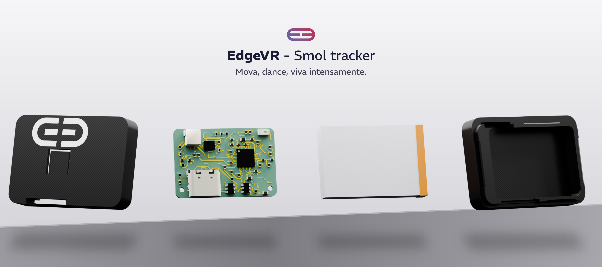

# EDGE · PCB design & hardware prototyping

**Mêitti Freitas · Hardware, embedded systems & product development**  
[GitHub](https://github.com/Meitti) · [EDGE VR](https://edgevr.store)

I develop electronics, mechanical parts and tools for VR products. This portfolio presents selected work from 2026: KiCad schematics and PCB layout, firmware bring-up, prototyping and the practical work of preparing a product for assembly.

*Exploded product render from the local EDGE project archive. This is a visualization, not a photograph or a certification of the current hardware revision.*

## Featured PCB projects

### EDGE nRF Tracker · VR tracking hardware

**My work:** KiCad schematics and PCB layout; enclosure iterations; embedded integration, firmware bring-up and bench diagnostics.

**Current stage:** hardware revisions and RF investigations in progress.

### EDGE nRF Receiver · Receiver hardware

**My work:** receiver PCB, embedded integration and radio testing.

**Current stage:** prototype development and revision review.

### EDGE Dock · Charging electronics

**My work:** charging dock electronics, including the ten-position Dock 10 described in my profile; mechanical integration and manufacturing preparation.

**Current stage:** multiple design revisions; engineering verification continues.

### Evidence and validation status

These descriptions identify my areas of contribution and the development stage of each project. This public presentation does not yet include revision-specific measurement or validation reports establishing RF performance or physical validation. Activities such as bench diagnostics and radio testing are not presented here as demonstrated performance results.

## Supporting mechanical work

| Project | Engineering work | Current context |
| --- | --- | --- |
| **Mechanical tooling** | Development-kit enclosure, tracker strap clips and SWD fixtures; parametric generation and print preparation | Iterative fit checks and physical prototype feedback |

The projects connect several disciplines: electronics, embedded software, CAD, printed enclosures, test fixtures and manufacturing documentation. Supporting work also includes packaging, product visualization and web integration.

## Sobre este portfólio

**Foco: design de PCB em KiCad e prototipagem de hardware.** Os três projetos em destaque são EDGE nRF Tracker, EDGE nRF Receiver e EDGE Dock. As revisões, protótipos e verificações seguem em andamento; esta apresentação pública ainda não inclui medições ou relatórios de validação por revisão.

Sou Mêitti Freitas. Aqui apresento uma seleção do meu trabalho com a EDGE: do esquema e layout da placa às peças impressas, testes de bancada e preparação para montagem.

O arquivo completo será organizado gradualmente em repositórios privados por projeto. Este espaço reúne somente material selecionado para apresentação pública. Descrições de revisão, protótipos e resultados de testes serão identificadas conforme a evidência disponível.

## Provenance and authorship

This portfolio is being assembled from an existing 2026 work archive. Repository publication dates record when material was imported or documented; they do not claim that the underlying engineering work was performed on those dates.

Attribution applies to my original contributions. Components, upstream projects, reference designs and tools retain their respective authorship and terms. Public source releases require a separate provenance and license review.

Original portfolio material © 2026 Mêitti Freitas / EDGE. All rights reserved. See [COPYRIGHT.md](COPYRIGHT.md) and [THIRD_PARTY_NOTICES.md](THIRD_PARTY_NOTICES.md). For collaboration or permission requests, contact me through my [GitHub profile](https://github.com/Meitti).
